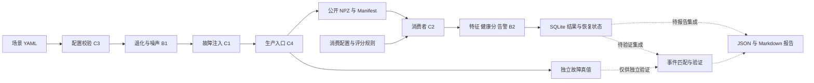
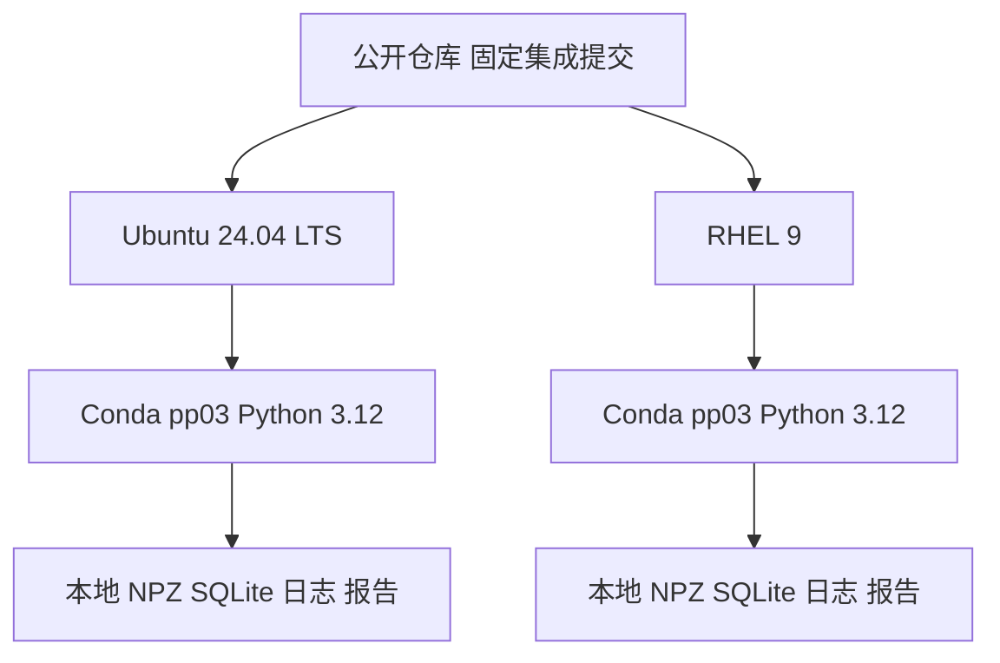

# G15 系统架构与集成状态

> Issue [#2](https://github.com/Zhu-ShuH/g15-predictive-maintenance/issues/2)；负责人 A；2026-10-28。实现快照：main `75b119454a1ac075620bdcc74826730fa7b4ac02`。本页描述现有实现和目标链路，公共契约仍以 [interface](interface.md) 及其实际评审记录为准。

## 1. 当前主线与目标边界

配置、仿真、故障注入、Schema/NPZ/Manifest、生产入口、分析、消费及 SQLite 已合入主线。共享 `SimulationChunk` 已由 [#31](https://github.com/Zhu-ShuH/g15-predictive-maintenance/pull/31) 迁到 `common/types.py`，不再处于“等待迁移”状态。

上述模块可通过 Python 入口组合；**命令行和报告闭环尚未全部集成**。当前 `cli.py` 只实现 validate；simulate、consume、report、verify、benchmark、doctor 仍走占位分支。主线 `reporting/builder.py`、`metrics.py` 为空；shell 脚本虽已补可执行位，内容仍失败退出。不能直接按下图的完整目标链宣称演示可运行。

实线表达已合入模块之间的数据职责，不代替本次执行记录；虚线部分为尚待集成的验证/报告路径。真值分目录属于代码访问约定，不是操作系统权限隔离。consumer/analysis 不能用真值决定预测结果。

## 2. 模块、证据与接线状态

| 模块 | 主责 | 主线实物 / 证据 | 当前限制 |
|---|---|---|---|
| config / CLI | C3 | `config.py` 与 validate，[#26](https://github.com/Zhu-ShuH/g15-predictive-maintenance/pull/26)、[#55](https://github.com/Zhu-ShuH/g15-predictive-maintenance/pull/55) | consume 接线为 [#71](https://github.com/Zhu-ShuH/g15-predictive-maintenance/pull/71) 候选，其余占位命令不能当业务成功 |
| simulation | B1 / C1 | engine/degradation/noise/faults，[#15](https://github.com/Zhu-ShuH/g15-predictive-maintenance/pull/15)、[#27](https://github.com/Zhu-ShuH/g15-predictive-maintenance/pull/27)、[#42](https://github.com/Zhu-ShuH/g15-predictive-maintenance/pull/42)、[#47](https://github.com/Zhu-ShuH/g15-predictive-maintenance/pull/47) | 仿真只产测量/真值，不计算健康分、不读取 SQLite |
| schema / serialization / producer | C4 | [#29](https://github.com/Zhu-ShuH/g15-predictive-maintenance/pull/29)、[#30](https://github.com/Zhu-ShuH/g15-predictive-maintenance/pull/30)、[#43](https://github.com/Zhu-ShuH/g15-predictive-maintenance/pull/43)、[#48](https://github.com/Zhu-ShuH/g15-predictive-maintenance/pull/48) | Manifest/四数组/完整发布语义按契约，不自行增加字段或改计时范围 |
| analysis | B2 | 特征、健康评分、告警，[#54](https://github.com/Zhu-ShuH/g15-predictive-maintenance/pull/54) | [#73](https://github.com/Zhu-ShuH/g15-predictive-maintenance/pull/73) 数值边界仍待修，不提前写为主线已解决 |
| consumer / storage | C2 | 公开文件消费、窗口结果、恢复状态与事务，[#64](https://github.com/Zhu-ShuH/g15-predictive-maintenance/pull/64) | [#76](https://github.com/Zhu-ShuH/g15-predictive-maintenance/pull/76) 末片上界候选未集成；真实强杀与公共契约仍待收口 |
| reporting / verify | 原分工 C5；#9/#51 当前相关实现由 B1 接手 | 候选 [#70](https://github.com/Zhu-ShuH/g15-predictive-maintenance/pull/70)、[#72](https://github.com/Zhu-ShuH/g15-predictive-maintenance/pull/72) | 主线模块仍空；原始分片校验不等于真值匹配、检出率或完整时间轴验证 |
| scripts / environment | C6；A 协调依赖与验收 | [#59](https://github.com/Zhu-ShuH/g15-predictive-maintenance/pull/59) 修正执行位；[environment](environment.md) | setup/demo/verify/benchmark 仍是占位；[#10](https://github.com/Zhu-ShuH/g15-predictive-maintenance/issues/10)、[#28](https://github.com/Zhu-ShuH/g15-predictive-maintenance/issues/28) 保留 |

## 3. 文件交换与持久化责任

一次 run 对应一台设备。公开分片包含等长一维 `seq:int64`、`timestamp_ns:int64`、`vibration:float64`、`temperature:float64`，单位为 g/degC；生产原子发布 NPZ、独立真值和最终 complete Manifest。序号、时间、单位、路径、行数与摘要的具体约束见 [interface](interface.md)，本页不另定义一套公共规则。

消费者从公开分片和消费规则形成窗口，调用 analysis，将窗口、健康分、告警、恢复状态及 processed 标记按分片事务提交。当前实现有 runs、processed_chunks、feature_windows、alarms、alarm_states；“实现已有表”不等于对应公共持久化字段已经完成全部评审。候选 [ADR-0005](adr/0005-analysis-persistence-contract.md) 已入库但仍为提案，接口正文 [#67](https://github.com/Zhu-ShuH/g15-predictive-maintenance/pull/67) 未合并。

逐片事务不承诺整个 run 出错时全回滚。特别是短尾 `error` 可能在较早分片已提交后报错；#76 候选保证的是新增末片上界预检在业务写入前拒收，不能将两类失败混为“五表始终零写入”。单片运行没有可供反推的名义分片长度，不添加新的 Manifest/config 字段。

恢复从已提交 processed 标记及持久状态继续，同分片内容改变应拒绝重放。单元测试、进程强杀、断电是不同证据层级；没有实测的层级保持未验证。源数据、虚拟环境、运行库与大型报告原始目录不提交到仓库。

## 4. 双系统目标部署

这是目标部署图。两个系统须各自全新克隆、安装、运行；CI 的两个 Python 版本不能替代两个 Linux。安装可联网，业务运行不依赖在线服务。C6 需确认 RHEL 软件源、解释器、离线备用包并记录真实失败；依赖锁定和两系统证据完成前不标部署通过。

## 5. 决策、候选与下一步

| 议题 | 已有实物 / 决定 | 后续责任与证据 |
|---|---|---|
| 共享类型、RNG、空块 | #31/#37 已合入，见 [ADR-0003](adr/0003-shared-types-and-randomness.md) | 后续变更仍按 §13；不继续等待已完成的 #17 首次迁移 |
| 采样率和时间戳边界 | #42/#47/#50/#55 已合入 | B1/C3 保持配置与内核一致；#72 原始校验当前未核绝对时间公式 |
| 生产失败与末片等号 | #48 修生产失败发布，#68 将上界契约改为含等号 | C2 的实际末片上界预检在 #76；集成后 A 再同步相关接口现状 |
| 分析持久化 | #54/#64 实现已入主线，#61 ADR 提案已入库 | A/B2/C2/C4 等完成 #57/#67 的真实意见、兼容与接口同步 |
| 独立验证 | #62 提交 [ADR-0006](adr/0006-independent-validation-protocol.md) | #56 的保留数据方案、规则/标准冻结、实际首次执行仍待交付；不先跑新 seed |
| 完整生产性能 | #53 留 Windows 完整生产证据 | 双 Linux、RSS/CLI 口径与 #51 补充继续留证，不将 Windows 结果升级为最终验收 |

集成顺序为：收敛候选及真实 Review → 按 §13 同步受影响接口 → 接 CLI/报告与脚本 → 固定集成版本 → 双 Linux 兼容、故障恢复与验收证据。可并行准备文档和测试方案，不能用临时成功结果、合并 ADR 或文档状态更新替代这些门禁。
