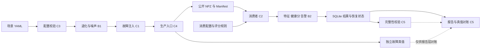
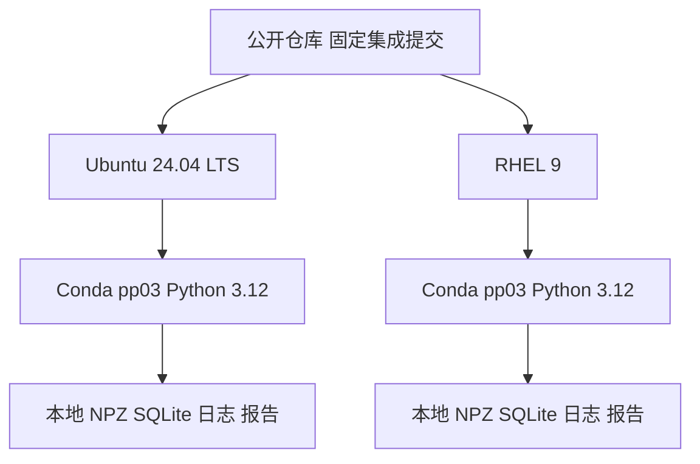

# G15 系统架构与集成状态

> Issue [#2](https://github.com/Zhu-ShuH/g15-predictive-maintenance/issues/2)；负责人 A；
> 2026-11-10 按 [Issue #142](https://github.com/Zhu-ShuH/g15-predictive-maintenance/issues/142)
> 核对到 `main@997acaebef2d4ab72639954afe8078bd9a04452b`。本页描述现有实现、
> 安全边界和待验收扩展；公共契约仍以 [interface](interface.md) 及实际 Review 为准。

## 1. 当前主线与目标边界

配置、仿真、故障注入、Schema/NPZ/Manifest、生产入口、分析、消费、SQLite、报告与
完整性校验均已落入主线。`validate`、`simulate`、`consume`、`report`、`benchmark`、
`reset-alarms` 已接线；`verify` 与 `doctor` 的 Python CLI 仍未接线，但独立
`scripts/verify.sh` 已具备质量、测试、配置和闭环门禁。脚本或模块存在不等于最终候选 SHA
已经完成教师现场验收。

实线表达当前主链的数据职责，不代替本次运行记录。真值分目录属于代码访问约定，不是操作系统权限隔离。真值只由报告层（`reporting.builder` / `reporting.metrics`）读取用于真值对账；`reporting.verifier` 只做 Manifest/NPZ 完整性校验，不读真值；consumer/analysis 不能用真值决定预测结果。

## 2. 模块、证据与接线状态

| 模块 | 主责 | 当前主线实物 | 当前限制 / 终验边界 |
|---|---|---|---|
| config / CLI | C3 | YAML 严格校验；validate/simulate/consume/report/benchmark/reset-alarms 已接线 | Python CLI `verify`/`doctor` 未接线；公共参数/退出码仍按 interface 变更流程 |
| simulation / faults | B1 / C1 | 趋势、噪声、spike/step/burst、确定性随机流与真值生成 | 只产测量/真值，不计算健康分；最终百万点需同一 SHA 双 Linux 三次复证 |
| schema / producer | C4 | Schema 2.0、NPZ、SHA、原子 complete Manifest、末片上界 | 真值隔离是代码边界，不是 OS 权限；不得擅自扩字段或改变计时窗口 |
| analysis | B2 | FEATURES_VERSION 1.2；特征、健康评分、告警、掩码/数值边界 | 启发式教学模型，不宣称真实工业诊断精度；规则更改须版本化和复验 |
| consumer / storage | C2 | 五表、按片事务、幂等、只读连接、状态恢复与 reset-alarms | reset 历史在可变状态信封中，不满足 append-only 安全审计；须独立立项实现 |
| reporting / verifier | B1 承接原 C5 | JSON/Markdown 报告、真值对账、独立原始分片校验 | #56→#9 的独立保留集未完成；verifier 不读真值，不能与报告层职责混写 |
| scripts / environment | C6 | setup/demo/verify/benchmark/clean、依赖锁、双 Linux 历史证据 | 最终候选 SHA 仍需 clean clone、禁网与现场故障同批复验 |
| query / service | A/B1 | ADR-0007、需求和候选契约已入库 | `src/g15/query`/`service` 已实现并合入（#149）；#136 Gate 0 之前不得声称 p95、EXPLAIN 或 100k 通过 |

## 3. 文件交换与持久化责任

一次 run 对应一台设备。公开分片包含等长一维 `seq:int64`、`timestamp_ns:int64`、`vibration:float64`、`temperature:float64`，单位为 g/degC；生产原子发布 NPZ、独立真值和最终 complete Manifest。序号、时间、单位、路径、行数与摘要的具体约束见 [interface](interface.md)，本页不另定义一套公共规则。

消费者从公开分片和消费规则形成窗口，调用 analysis，将窗口、健康分、告警、恢复状态及 processed 标记按分片事务提交。当前实现有 runs、processed_chunks、feature_windows、alarms、alarm_states；“实现已有表”不等于对应公共持久化字段已经完成全部评审。候选 [ADR-0005](adr/0005-analysis-persistence-contract.md) 已入库但仍为提案，接口正文 [#67](https://github.com/Zhu-ShuH/g15-predictive-maintenance/pull/67) 未合并。

逐片事务不承诺整个 run 出错时全回滚。特别是短尾 `error` 可能在较早分片已提交后报错；#76 已合入的实现保证的是新增末片上界预检在业务写入前拒收，不能将两类失败混为“五表始终零写入”。单片运行没有可供反推的名义分片长度，不添加新的 Manifest/config 字段。

恢复从已提交 processed 标记及持久状态继续，同分片内容改变应拒绝重放。单元测试、进程强杀、断电是不同证据层级；没有实测的层级保持未验证。源数据、虚拟环境、运行库与大型报告原始目录不提交到仓库。

## 4. 双系统目标部署

两个系统已有历史部署证据，但最终候选 SHA 仍须各自全新克隆、安装、运行；CI 的两个 Python 版本不能替代两个 Linux。安装可联网，主链业务运行不依赖在线服务。C6 需在依赖预装后实施禁网 demo/verify，并记录系统、硬件、命令、退出码、失败与恢复。断网运行不等于离线安装已经验证。

## 5. 安全与真实设备边界

当前组件图中没有设备协议适配器、执行器或自动停机控制：系统只生成数据、健康分、告警和报告。
因此“真实设备变更单/旁路/双人复核”和“误停人工确认”对当前运行路径为不适用，但构成禁止扩展边界：

1. 未经新 Issue、ADR、变更单、只读旁路、回退方案和两位非作者 Review，不得接入真实设备。
2. 告警不得直接触发停机或维护动作；未来控制动作必须独立授权、人工确认、append-only 审计和故障回退。
3. `reset-alarms --yes --reason` 只重置告警 streak，不删除历史告警、不控制设备，也不等于安全审计红线完成。
4. 当前产品不存储密码；#135 如引入口令须先冻结认证契约并使用强哈希。任何凭据、PII、真值和自由文本审计原文不得进入普通查询响应或日志。
5. 主链数据均为本地仿真；真实工业数据不得进入公开仓库、fixture 或第三方 AI，外发必须经脱敏和授权。

## 6. 决策、候选与下一步

| 议题 | 已有实物 / 决定 | 后续责任与证据 |
|---|---|---|
| 共享类型、RNG、空块 | #31/#37 已合入，见 [ADR-0003](adr/0003-shared-types-and-randomness.md) | 后续变更仍按 §13；不继续等待已完成的 #17 首次迁移 |
| 采样率和时间戳边界 | #42/#47/#50/#55 已合入 | B1/C3 保持配置与内核一致；#72 原始校验当前未核绝对时间公式 |
| 生产失败与末片等号 | #48 修生产失败发布，#68 将上界契约改为含等号 | C2 的末片上界预检 #76 已合入；A在#67同步实际现状并重新送审，接口条件不由代码集成代替 |
| 分析持久化 | #54/#64 实现已入主线，#61 ADR 提案已入库 | A/B2/C2/C4 等完成 #57/#67 的真实意见、兼容与接口同步 |
| 独立验证 | #62 提交 [ADR-0006](adr/0006-independent-validation-protocol.md) | #56 的保留数据方案、规则/标准冻结、实际首次执行仍待交付；不先跑新 seed |
| 完整生产性能 | #53 留 Windows 完整生产证据 | 双 Linux、RSS/CLI 口径与 #51 补充继续留证，不将 Windows 结果升级为最终验收 |

集成顺序为：收敛候选及真实 Review → 按 §13 同步受影响接口 → 接 CLI/报告与脚本 → 固定集成版本 → 双 Linux 兼容、故障恢复与验收证据。可并行准备文档和测试方案，不能用临时成功结果、合并 ADR 或文档状态更新替代这些门禁。
