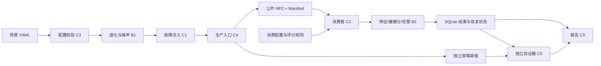
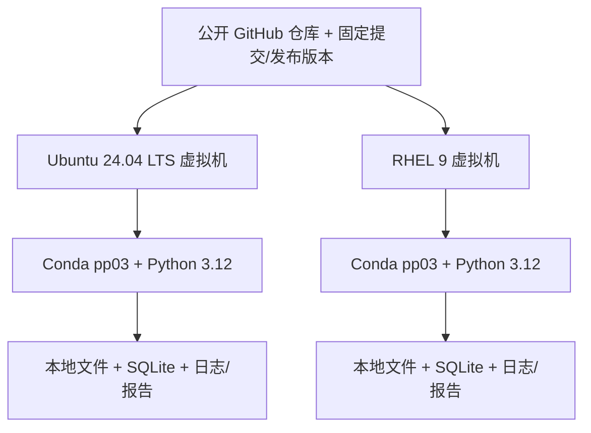

# G15 系统架构与接口评审草案

> **2026-10-16 组长决定**：采用小组默认验收口径，不再等待教师逐项答复。标准见 `docs/acceptance.md`；正式开发和演示环境为 Conda `pp03` + Python 3.12，步骤见 `docs/environment.md`。Python 3.11 保留兼容性 CI。公共 API、状态字段仍需真实评审，所有验收成绩仍须实测。

> Issue #2；负责人 A；2026-10-18；待团队评审。以下为目标结构；PR #15 已合并（main `2c14759`），其余主链尚未联通。

## 1. 组件与数据流

消费者只读取公开测量、Manifest 和消费规则；真值只用于独立验证。分目录是代码层隔离，不等于操作系统权限隔离。生产与消费通过独立 CLI 运行，算法函数不读文件或访问数据库。

## 2. 文件与持久化

一次 run 对应一台设备，四个等长数组为 seq:int64、timestamp_ns:int64、vibration:float64、temperature:float64。Manifest 包含运行/设备/Schema、单位、采样率、点数和全部分片的路径、行数、SHA；只有 complete 可消费。分片先临时写入，再原子更名，最后发布完整 Manifest。

运行目录按 docs/interface.md：raw/、private_truth/、artifacts/results.sqlite、reports/、logs/、evidence/。SQLite 四张核心表为 runs、processed_chunks、feature_windows、alarms；alarm_states 为待评审状态表。结果、状态与分片完成标记同事务，重启后从已提交游标继续。源数据及运行数据库不入库，仓库保留可重建的小 fixture。

## 3. 模块边界

| 模块 | 负责人 | 输入 → 输出 | 禁止 |
|---|---|---|---|
| config/CLI | C3 | 两类 YAML → 分离的不可变配置；参数 → 模块入口 | CLI 写业务公式或把故障配置交消费者 |
| simulation | B1/C1 | 场景/绝对序号/seed → 测量及独立真值 | 计算健康分或读 SQLite |
| schema/serialization/producer | C4 | 公共对象 → NPZ/Manifest/run_dir | 自改算法、未经评审增加字段 |
| analysis | B2 | 连续测量窗口/规则/显式状态 → 特征、评分、告警、下一状态 | 读取真值或处理文件 I/O |
| consumer/storage | C2 | 公开文件/规则 → 事务性结果与恢复游标 | 忽略同分片内容变化、只存内存状态 |
| reporting/verify | C5 | 结果与独立真值 → 匹配统计、报告 | 用真值修改消费者预测 |
| scripts/env | C6 | 同一代码版本 → 可复现安装与运行证据 | 吞掉失败退出码、假造环境日志 |

## 4. 部署图

两台虚拟机各自从空目录克隆；不能以 CI 的两个 Python 版本替代两种 Linux。C6 先确认 RHEL 软件仓库与解释器；安装联网、运行离线。依赖当前未锁定，双环境验证后由 A 的独立依赖任务定稿。

## 5. 评审议题与建议（不是会议纪要）

| 议题 | A 的建议 | 推动负责人 / 任务 | 需要反馈者 | 当前结论与待决项 / 证据 |
|---|---|---|---|---|
| NPZ + Manifest | 按 ADR-0002；CSV 仅导出 | A；C4 实现 #3，C2 接入 #8 | C3/C4/C2/C5 | #29 实现评审中，单位与损坏文件等意见待修；不能把 PR 已提交写成契约已通过 |
| SimulationChunk 位置 | 唯一定义放 common/types.py，engine 同对象重导出 | A / #17 | B1/C4/C3/C1 | #17 已立项且 B1/C4 已反馈；迁移未实施。C4 运行时 import 后续需按范围改为 common |
| RNG 与 seed | 保留可选 rng，拟统一不消费状态；固定块与子流寻址 | A / #17 | B1/C1/C3/C4 | B1 倾向兼容参数不消费；C4 原文为可声明不消费，最终措辞须记录差别并复审 |
| 负值 | 不静默钳位；单位固定 g/degC，非有限值拒绝 | A 协调；B1 生成、C3 配置、B2 算法 | B1/B2/C3 | B1 已实现并测试有限负值不钳位；B2/C3 的边界反馈与整体契约仍待确认 |
| 跨片事件与告警状态 | 半开区间；真值按 event_id 去重；状态同事务 | A 协调 #6/#7/#8/#9/#11 | C1/B2/C2/C4/C5 | #27 当前实现加性叠加；短 burst 尚待修。告警状态与 C5 独立评估仍待真实反馈，不视为已冻结 |

已收到 [C4 2026-10-18 的逐项意见](https://github.com/Zhu-ShuH/g15-predictive-maintenance/issues/17#issuecomment-6247508474)及 [B1 同日完整回复](https://github.com/Zhu-ShuH/g15-predictive-maintenance/issues/17#issuecomment-6247619901)。这是线上反馈，未虚构会议或全员批准；本表负责人负责推动闭环，不替尚未反馈者签字。#17 定稿及迁移后继续回填结论，Issue #2 尚未完成。ADR-0001 由 PR #15 占用，本 Issue 使用 0002–0004 避免编号冲突。

## 6. 集成次序

先确认共享对象与小 fixture，然后 #3/#4 配置和序列化、#5 仿真；#11 先跑无故障生产再接 #6；#7 算法和 #8 消费接成闭环；最后 #9 验证/报告和 #10 双系统部署。各模块可以先用独立手算样例开发，不能用临时假成功结果替代最终验收。
